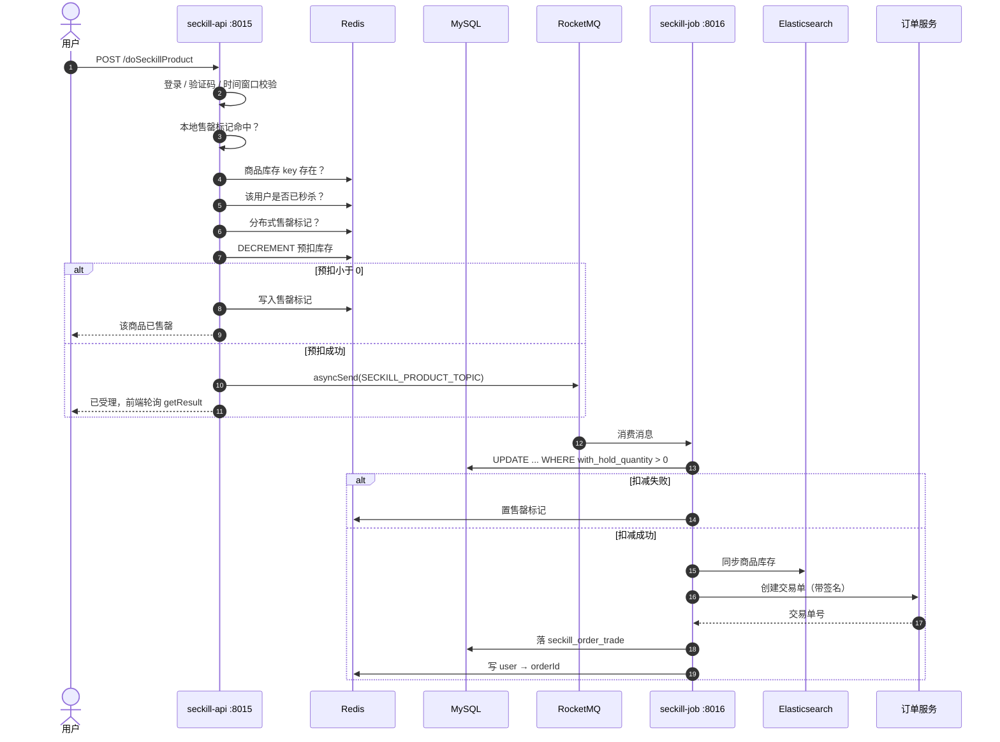

<div align="center">
  <h2>Seckill</h2>

  <p>
    
    
    
    
    
    
    
    <a href="./LICENSE"></a>
  </p>
</div>

<div align="center">

面向瞬时高并发的 <strong>秒杀系统</strong>。

通过四段式「本地售罄标记 → Redis 原子预扣 → MQ 异步削峰 → DB 条件扣减」把抢购流量挡在数据库之前，缓解高并发场景。

</div>

## 核心功能

秒杀的难点在于**一件商品只有 100 件，1000人同时点，怎么保证不超卖、不卡死**。核心设计围绕这一点。

### 🚦 四段式库存闸门

> 每一层都比下一层便宜，流量被逐级削薄，最终只有少数请求会摸到数据库。

- **本地售罄标记** — `ConcurrentHashMap` 记下已售罄商品，命中直接抛错，**连 Redis 都不访问**，是最便宜的一道闸。
- **Redis 原子预扣** — `DECREMENT` 单线程原子，返回值小于 0 说明库存已被扣穿，立刻回写售罄标记。所有实例共享同一个计数器，这一层决定谁能进下一关。
- **MQ 异步削峰** — 预扣成功后只发一条 RocketMQ 消息就返回，请求线程立刻释放；数据库写入压力从「瞬时并发」变成「消息消费速率」。
- **DB 条件扣减** — SQL 自带乐观条件，影响行数为 0 就是没抢到，不是异常：

```sql
UPDATE seckill_product
SET with_hold_quantity = with_hold_quantity - 1
WHERE id = #{id} AND with_hold_quantity > 0
```

### 📦 双字段库存模型

> Redis 管「能不能卖」，数据库管「实际还剩多少」，两者职责分开。

| 字段 | 含义 | 谁维护 |
| :--- | :--- | :--- |
| `with_hold_quantity` | 预扣库存 | Redis 计数器 + DB 条件更新 |
| `remain_quantity` | 实际剩余库存 | 支付/取消后按实际成交回写 |

取舍很明确：**宁可少卖，不可超卖**。Redis 预扣成功但 DB 扣减失败时，这件商品就算白扣了——业务上可以接受，超卖不行。

### 🛡️ 防刷与请求削减

> 在进入库存判断之前，先把无效请求挡掉。

- **算术验证码** — 每次秒杀带 `uuid + code`，验证码存 Redis（默认 60 秒），**校验后立即删除**，一次性使用无法复用。
- **重复秒杀拦截** — Redis key `userSeckillProduct:{商品id}_{用户名}`，一个用户对一件商品只放行一次。
- **分布式售罄标记** — `seckillProductOver:{id}`，防止多实例下某个实例的本地标记不准。
- **密码链路** — 前端 JSEncrypt 用内置公钥加密，后端 RSA 解密后走 BCrypt 比对。

### 🔍 检索与页面

- **ES 检索** — 商品列表走 Elasticsearch 的 `matchQuery(name)`，索引 `seckill-product-es-index-v1`；库存变化后同步更新 ES 副本。
- **Thymeleaf 页面** — 登录、商品列表、商品详情、订单详情四个页面，Bootstrap + Element-UI。
- **结果轮询** — 秒杀接口只返回「已受理」，前端拿 `getResult` 轮询，从 Redis 取到订单号才算下单成功。

## 系统流程



## 技术栈

| 层次 | 技术 | 用途 |
| :--- | :--- | :--- |
| 语言与框架 | Java 8、Spring Boot 2.7.18、Spring MVC | 基础运行环境 |
| 页面 | Thymeleaf、Bootstrap、Element-UI | 四个页面与前端交互 |
| 数据访问 | MyBatis 2.3.2、Druid、MySQL 8 | 商品与订单持久化 |
| 缓存与闸门 | Redis | 预扣库存、验证码、去重、售罄标记 |
| 消息 | RocketMQ | 异步削峰、解耦下单 |
| 检索 | Elasticsearch（RestHighLevelClient） | 商品列表搜索与库存同步 |
| 安全 | JWT、easy-captcha、JSEncrypt + BCrypt | 登录态、验证码、密码加解密 |
| 文档 | Swagger 3.0.0、Hutool | 接口文档与工具类 |

## 本地运行

### 环境要求

| 组件 | 要求 | 说明 |
| :--- | :--- | :--- |
| JDK | 8 | 后端运行环境 |
| Maven | 3.6+ | 多模块构建 |
| MySQL | 8.0+ | 库名 `seckill`，字符集 `utf8mb4` |
| Redis | 6.0+ | 默认 `database: 5` |
| RocketMQ | 4.x / 5.x | NameServer 默认 `127.0.0.1:9876` |
| Elasticsearch | 7.x | 索引 `seckill-product-es-index-v1` |
| 依赖库 | `lib/mall-common-1.0.0.jar` | 业务层的 24 个类来自该 jar，随仓库提供 |
| 订单服务 | 可访问的 HTTP 端点 | 秒杀成功后由它创建交易单，地址在 `seckill.orderApiProperties.host` |

### 1. 初始化数据库

```bash
mysql -u root -p < sql/01_schema.sql
mysql -u root -p seckill < sql/02_order_table.sql
```

第一个脚本建 `seckill_product` 并写入 4 件演示商品，第二个建 `seckill_order_trade`。演示商品的秒杀窗口用 `DATE_ADD(NOW(), INTERVAL ...)` 生成，**导入后立即处于进行中状态**，不需要手动改时间。

### 2. 准备配置

两个 `application.yml` 需要改成自己的环境：

```text
seckill-api/src/main/resources/application.yml    ← MySQL / Redis / ES / RocketMQ
seckill-job/src/main/resources/application.yml    ← 同上 + 订单服务地址
```

默认值均为 `127.0.0.1`，中间件口令统一 `seckill123`，MySQL 为 `123456`。

### 3. 启动

```bash
mvn clean package -DskipTests

java -jar seckill-api/target/seckill-api-1.0.0.jar    # 接口与页面，:8015
java -jar seckill-job/target/seckill-job-1.0.0.jar    # MQ 消费者，:8016
```

### 4. 访问

| 地址 | 说明 |
| :--- | :--- |
| `http://localhost:8015/login` | 登录页，先取验证码 |
| `http://localhost:8015/productList` | 秒杀商品列表 |
| `http://localhost:8015/productDetail/{id}` | 商品详情与秒杀按钮 |
| `http://localhost:8015/orderDetail/{id}` | 订单详情 |

接口一览：`POST /doLogin`、`GET /code`、`POST /doSeckillProduct`、`POST /getResult`、`POST /searchProductList`、`GET /getUserInfo`。

### 常见问题

| 现象 | 处理方式 |
| :--- | :--- |
| 编译报找不到 `cn.net.susan.util.*` | `lib/mall-common-1.0.0.jar` 缺失，确认在仓库根目录的 `lib/` 下 |
| 打包成功但启动 `NoClassDefFoundError` | `system` scope 默认不参与打包，需在 spring-boot-maven-plugin 加 `<includeSystemScope>true</includeSystemScope>` |
| 秒杀成功但查不到订单 | `getResult` 从 Redis 取订单号，说明 job 没消费到消息；检查 RocketMQ NameServer 与 consumer group |
| 下单报签名错误 | 订单服务与 `secretKey` 不一致 |
| ES 查询报索引不存在 | 需先建索引 `seckill-product-es-index-v1` 并灌入商品数据 |
| 商品补了库存但仍提示已售罄 | 本地售罄标记在 JVM 内存中，重启 `seckill-api` 即可 |
| 页面登录提示验证码错误 | 验证码 60 秒过期且一次性，重新获取 |

## 目录结构

```text
seckill-master
├── seckill-api/                 # 页面与 REST 接口（:8015）
│   └── src/main/resources/
│       ├── templates/           # login / product_list / product_detail / order_detail
│       └── static/              # Bootstrap、Element-UI、图片
├── seckill-business/            # 业务层：service / mapper / entity / config
│   └── src/main/resources/
│       ├── cn/net/susan/.../mapper/   # MyBatis XML
│       └── mybatis-config.xml
├── seckill-job/                 # MQ 消费者（:8016）
├── lib/mall-common-1.0.0.jar    # 公共模块依赖
├── sql/                         # 01_schema / 02_order_table
└── pom.xml
```

## License

本项目基于 [Mozilla Public License 2.0](LICENSE) 开源。
